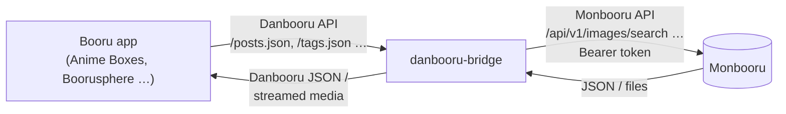

# monbooru-danbooru-bridge

A small translator that lets **Danbooru-compatible booru apps** (Anime Boxes, Boorusphere and similar) browse a self-hosted **[Monbooru](https://github.com/monbooru/monbooru)** library.

The apps think they are talking to a Danbooru site. The bridge turns every request into a call against the Monbooru REST API and converts the answer back into Danbooru-style JSON. Images and videos are streamed through the bridge, so your phone never sees the Monbooru token.

- One Python file, standard library only (Python 3.8+), no `pip install`
- Registers itself with Monbooru through Monbooru's plugin pairing, no manual token handling
- Read-only by default, favorites optional
- Optional API key and IP allowlist

> [!WARNING]
> **This is a vibe-coded project.**
> I'm not a professional developer. The code was written with an AI assistant (Claude by Anthropic), and I tested it on my own setup and against a mocked Monbooru server. It has not been reviewed by anyone else and comes without warranty (see [LICENSE](LICENSE)).
> Read the code before you run it, and don't expose the bridge to the internet without an API key and HTTPS. Issues and pull requests are welcome.

This project is not affiliated with Monbooru, Danbooru or any of the apps mentioned.

---

## How it works



### 1. Pairing with Monbooru

On first start the bridge sends a pairing request to Monbooru (`POST /api/v1/pair/request`) with the scope `read` (plus `write` if favorites are enabled). You approve it once in the Monbooru settings. Monbooru checks the bridge's `/health` endpoint at `BRIDGE_SELF_URL`, then hands out a token.

The token is stored in `data/state.json` (file mode `0600`). If Monbooru ever rejects the token (HTTP 401), the bridge throws it away and asks for a new pairing automatically.

### 2. Translating requests

| Danbooru endpoint (what the app calls) | What the bridge does |
|---|---|
| `GET /posts.json` | Search via `/api/v1/images/search`, convert results into Danbooru posts |
| `GET /posts/{id}.json` | Single image via `/api/v1/images/{id}` |
| `GET /posts/random.json` | Random search, first hit |
| `GET /counts/posts.json` | Total number of hits for a search |
| `GET /tags.json` | Tag list and tag lookup (incl. `search[name_comma]` for categories) |
| `GET /autocomplete.json`, `GET /tags/autocomplete.json` | Tag suggestions sorted by usage |
| `GET /favorites.json`, `POST /favorites.json`, `DELETE /favorites/{id}` | Monbooru favorites (writing only with `BRIDGE_FAVORITES=1`) |
| `GET /profile.json`, `GET /users/{id}.json` | Dummy user, so apps accept the login |
| `/pools`, `/notes`, `/comments`, `/wiki_pages`, `/artists` … | Empty list (Monbooru has no such data) |
| `GET /data/…`, `/sample/…`, `/preview/…` | Streams the file, still/sample or thumbnail from Monbooru (HTTP range requests work, so video seeking does) |
| `GET /favicon.ico` | Passes Monbooru's icon through (cached for a day) |
| `GET /health` | Status for Monbooru and for you (`{"paired": true}`) |

### 3. Converting the data

- **Tag categories:** Monbooru's `general`, `artist`, `copyright`, `character` and `meta` become Danbooru categories 0, 1, 3, 4 and 5. Spaces in tag names become underscores.
- **Rating:** Danbooru's `g/s/q/e` is read from tags in Monbooru's `rating` category (`general`, `sensitive`, `questionable`, `explicit` by default, configurable with `BRIDGE_RATING_TAGS`). Images without a rating tag get `BRIDGE_DEFAULT_RATING`.
- **Search syntax:**
  - Normal tags and `-tag` are passed through.
  - `rating:e`, `rating:explicit` and the like become the matching Monbooru rating tag.
  - `order:random`, `order:id`, `order:id_asc`, `order:id_desc` and `order:filesize(_asc)` become Monbooru sort options. Random searches use a seed that changes every 10 minutes, so paging stays stable.
  - `fav:…` and `ordfav:…` become `fav:true`.
  - `~a ~b` becomes `a OR b`.
  - Danbooru meta-tags Monbooru doesn't know (`score:`, `user:`, `pool:`, `md5:`, `status:` …) are dropped. With `BRIDGE_LOG=DEBUG` you can see which ones.
- **Files:** AVIF and JXL images get a WebP sample as `large_file_url`, because many apps can't show those formats. CBZ archives show their cover.

---

## Setup

### Requirements

- A running Monbooru instance with the plugin/pairing API (see the [Monbooru plugin docs](https://monbooru.github.io/mondocs/addons/plugins.html))
- Docker with Docker Compose, or any Python 3.8+
- Monbooru must be able to reach the bridge (for the health check during pairing), and the bridge must be able to reach Monbooru

### Docker Compose (recommended)

1. Clone the repository on the server:
   ```bash
   git clone https://github.com/Schw1/monbooru-danbooru-bridge.git
   cd monbooru-danbooru-bridge
   ```
2. Edit `compose.yaml`:
   - `MONBOORU_URL`: the address under which the bridge reaches Monbooru.
   - `BRIDGE_SELF_URL`: the address under which **Monbooru** reaches the bridge. If both run on the same host with published ports, use the host's LAN IP and the **host** port (the left side of `ports:`), not `localhost`.
   - `BRIDGE_API_KEY`: a long random string, for example from `openssl rand -hex 24`.
   - `BRIDGE_ALLOW`: your LAN range, or remove the line.
3. Start it:
   ```bash
   docker compose up -d
   docker compose logs -f
   ```
   The log should show `Pairing requested - approve 'danbooru-bridge' in the Monbooru settings`.
4. Approve the request in the Monbooru settings. The log then shows `Paired with Monbooru`.
5. Check it:
   ```bash
   curl http://<server-ip>:8456/health
   # {"version": "0.1.0", "app": "danbooru-bridge", "paired": true}
   ```

The compose file uses the plain `python:3.12-alpine` image and mounts the repository folder, so nothing is built. The pairing token ends up in `./data/`, which is ignored by Git. Keep that folder, otherwise you have to pair again.

### Without Docker

```bash
export MONBOORU_URL=http://192.168.1.10:8080
export BRIDGE_SELF_URL=http://192.168.1.20:8456
export BRIDGE_API_KEY=change-me
python3 danbooru_bridge.py
```

Started with `--managed`, the bridge exits when its stdin is closed. That's how Monbooru stops plugins it launches itself from its plugins folder.

### Adding it to an app

Add a new site of type **Danbooru** and use the bridge address as the URL, e.g. `https://dan.example.org` or `http://192.168.1.20:8456`.

If `BRIDGE_API_KEY` is set, enter it as the **API key**. The user name doesn't matter. The bridge accepts the key as Danbooru's `api_key` parameter, as the password of HTTP Basic auth, or as a Bearer token, so most apps work with their normal Danbooru login fields.

Tested with Anime Boxes and Boorusphere.

---

## Configuration

All settings are environment variables.

| Variable | Default | Description |
|---|---|---|
| `MONBOORU_URL` | `http://127.0.0.1:8080` | Base URL of Monbooru as seen from the bridge |
| `BRIDGE_SELF_URL` | `http://127.0.0.1:<port>` | Base URL of the bridge as seen from **Monbooru** (health check during pairing) |
| `BRIDGE_PUBLIC_URL` | derived from the request | Base URL the **app** uses, for `file_url`/`preview_file_url`. Without it, the bridge uses the `Host` header (or `X-Forwarded-Proto`/`X-Forwarded-Host` behind a reverse proxy) |
| `BRIDGE_PORT` | `8456` | Listen port inside the container |
| `BRIDGE_BIND` | `0.0.0.0` | Listen address |
| `BRIDGE_DATA_DIR` | `data` | Where the pairing token is stored. Keep it persistent |
| `BRIDGE_GALLERY` | active gallery | Monbooru gallery to expose |
| `BRIDGE_FAVORITES` | off | `1` = request write scope and let apps add/remove Monbooru favorites |
| `BRIDGE_API_KEY` | none | Shared secret for all API calls. Unset = open access (a warning is logged) |
| `BRIDGE_ALLOW` | none | Comma-separated client networks, e.g. `192.168.1.0/24,100.64.0.0/10`. Others get 403 |
| `BRIDGE_FAVICON_URL` | `<MONBOORU_URL>/favicon.ico` | Icon served at `/favicon.ico` |
| `BRIDGE_RATING_TAGS` | `g=general,s=sensitive,q=questionable,e=explicit` | Danbooru rating → tag name in Monbooru's rating category |
| `BRIDGE_DEFAULT_RATING` | `g` | Rating for images without a rating tag |
| `BRIDGE_LOG` | `INFO` | Log level. `DEBUG` also shows dropped search terms |

Changing `BRIDGE_FAVORITES` later needs a new pairing for the write scope: delete `data/state.json` and restart.

---

## Security

- **Set `BRIDGE_API_KEY`.** Without it, anyone who can reach the port can browse your whole library.
- **Image links don't contain the API key.** They carry a separate token derived from it (`?k=…`), because apps load images without login headers. A leaked image link therefore doesn't reveal the key, but it does open all images as long as the key stays the same. Change the key to invalidate old links.
- **Use HTTPS when you leave the LAN.** Put the bridge behind your reverse proxy (Nginx Proxy Manager, Caddy, Traefik …) and set `BRIDGE_PUBLIC_URL` to the HTTPS address.
- **`BRIDGE_ALLOW` sees the direct client IP.** Behind a reverse proxy that's the proxy's address, not the phone's. In that case restrict access at the proxy instead.
- `/health`, `/` and the favicon stay open, because Monbooru needs `/health` for pairing. They don't expose library data.
- Secrets (`api_key`, `k`) are masked in the log.

---

## Troubleshooting

| Problem | Cause and fix |
|---|---|
| Pairing never shows up in Monbooru, or fails | Monbooru can't reach `BRIDGE_SELF_URL`. Use the host's LAN IP and the published host port, then test with `curl` from the Monbooru host |
| `503 bridge is not paired with Monbooru yet` | Approve the pairing in the Monbooru settings |
| `401` in the bridge log | The app doesn't send the key. Enter it as the API key in the app's site settings |
| `403 … not in BRIDGE_ALLOW` | The client IP is outside the allowed networks (or you're behind a proxy, see above) |
| Videos load forever on Android (e.g. Boorusphere) | Android blocks plain HTTP for native video playback. Serve the bridge over HTTPS |
| No site icon in Boorusphere | Boorusphere fetches icons through an external icon service, so it only works with a public HTTPS domain |
| A search returns more than expected | An unsupported Danbooru meta-tag was dropped. Check with `BRIDGE_LOG=DEBUG` |
| `cursor-style page=… is not supported` | Only numbered pages work, not Danbooru's `a123`/`b123` cursors |

---

## Limitations

- No pools, notes/translations, comments, wiki or artist pages. The bridge answers those with empty lists.
- Score, uploader, parent/child relations and similar Danbooru fields are filled with neutral values.
- Many Danbooru meta-tags are ignored (see above).
- Single user: everyone with the key sees the same library and shares the same favorites.

## Credits

- [Monbooru](https://github.com/monbooru/monbooru) for the library and the plugin API
- [Danbooru](https://github.com/danbooru/danbooru) for the API this bridge imitates
- Written with [Claude](https://claude.ai) by Anthropic

## License

[MIT](LICENSE)
